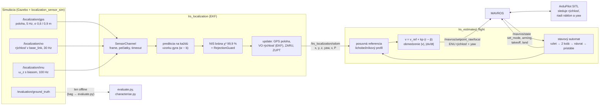
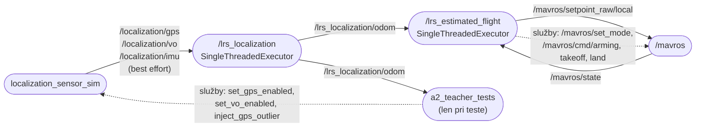

# A2 — Lokalizácia dronu: dokumentácia riešenia

Zadanie: [localization.md](../assignments/assignment2/localization.md). Dokument pokrýva požiadavku
na dokumentáciu ([pravidlo 5](../assignments/assignment2/README.md#rules-common-to-all-topics)):
čo sme zvolili, prečo, výhody a nevýhody a diagram riešenia. Rovnice, parametre a všetky merania sú v
[README balíka `lrs_localization`](../lrs_localization/README.md). Sem preberáme len to, čo treba
na zdôvodnenie rozhodnutí.

| Časť | Stav | Kde |
|---|---|---|
| §1 Charakterizácia senzorov | hotové | [a2_charakterizacia_senzorov.md](a2_charakterizacia_senzorov.md) |
| §2 Osemstavový filter | hotové | [`lrs_localization`](../lrs_localization/README.md#2-filter) |
| §3 Výpadky a chybné merania | hotové | [`lrs_localization`](../lrs_localization/README.md#3-missing-and-bad-measurements) |
| §4 Let na vlastnom odhade | hotové | [`estimated_flight_node`](../lrs_mission/src/estimated_flight_node.cpp), [README §4](../lrs_localization/README.md#4-flight-using-estimated-localisation) |

**Výstup odhadovača:** `/lrs_localization/odom` (`nav_msgs/Odometry`), frame `map` (ENU, frame GPS),
child `base_link`, 100 Hz.

## 1. Diagram riešenia

### Tok dát



Ground truth sa číta len offline z bagu (prerušovaná čiara). Odhadovač aj regulátor ho nikdy
nedostanú. Rovnako nečítajú nič z `/mavros/local_position/*`, `/mavros/global_position/*`,
`/mavros/odometry/*` ani `/mavros/imu/*`.

### ROS graf, uzly a vlákna



- **Oba uzly bežia v jednom vlákne** (`rclcpp::spin`, SingleThreadedExecutor). V odhadovači
  callbacky GPS, VO a IMU menia ten istý stav `x, P`. Keďže sa nikdy neprekrývajú, netreba zámky
  ani riešiť poradie zápisov. Výpočtová záťaž je malá (matica 8×8 pri 100 Hz), takže viac vlákien by
  nič nezrýchlilo.
- V regulátore sa odometria a stav MAVROS iba uložia. Celá logika beží v časovači 20 Hz, ktorý
  počíta všetky časy v simulačnom čase (`now()` pri `use_sim_time`). Volania služieb sú
  asynchrónne (`async_send_request` s callbackom), takže časovač nikdy nečaká na odpoveď.
- `ros2 node info /lrs_estimated_flight` počas každého letu ukázal odber len `/clock`,
  `/lrs_localization/odom`, `/mavros/state` a `/parameter_events`
  ([README §4](../lrs_localization/README.md#4-flight-using-estimated-localisation)).

## 2. Rozhodnutia: čo, prečo, výhody a nevýhody

### 2.1 Stav a model pohybu

**Čo:** stav `x = [x, y, z, vx, vy, vz, yaw, b]` v ENU (frame `map`). Model je konštantná
rýchlosť (zrýchlenie je biely šum s hustotou `q_acc`). Yaw sa integruje z gyra ako zo vstupu:
`yaw ← yaw + (ω − b)·dt`, `b` je bias gyra (náhodná prechádzka).

**Prečo:** poradie stavov predpisuje zadanie. Zrýchlomer nemáme (kovariancia −1, §1), takže
model konštantnej rýchlosti je jediný rozumný. Gyro ako vstup (nie meranie) je štandard: meria
priamo derivovanú veličinu a je 20× rýchlejšie ako GPS. Model je v `x` lineárny, preto je `F`
presná a nie je to linearizácia.

| + | − |
|---|---|
| jednoduché, presná diskretizácia `Q(dt)`, žiadna linearizácia v predikcii | zatáčky sú pre model „šum“; `q_acc_xy = 0,25` je kompromis medzi presnosťou na rovinke a sledovaním zatáčok |
| bias je stav, odhaduje sa | roll/pitch neodhadujeme (nie sú potrebné, výška a ENU rýchlosť stačia) |

### 2.2 Čo použiť z VO: telesová rýchlosť ako nelineárne meranie (EKF)

**Čo:** z VO fúzujeme len lineárnu rýchlosť v `base_link`, 10 Hz, σ 0,1 m/s. Meranie je
`h(x) = R(−yaw)·v`, s Jakobiánom aj podľa yaw. Poloha ani yaw z VO sa nepoužívajú.

**Prečo:**
- **Poloha VO** uteká aj pri stojacom drone (0,8 m za minútu, §1) a jej kovariancia (1 cm) to
  nepriznáva. Ako absolútna poloha je nepoužiteľná.
- **Yaw z VO** sme v kroku 4 fúzovali. Po hodine simulácie bol VO yaw 113° mimo a filter ho
  nasledoval. Na bagu s 8 min čakania na zemi: s VO yaw 13,2° RMS, bez neho 2,0° RMS.
- **Rýchlosť** nemá drift polohy, len pomaly sa meniaci bias. Viaže `v`, ktoré GPS (5 Hz, σ 0,6 m)
  určuje len slabo, a počas výpadku GPS nesie polohu.
- **EKF namiesto otočenia odhadnutým yaw** (lineárna aproximácia, ktorú zadanie povoľuje):
  stĺpec Jakobiánu podľa yaw robí z rozdielu medzi rýchlosťou z GPS (ENU) a z VO (body) informáciu
  o **kurze**. Počas letu sa tak yaw opravuje bez akéhokoľvek senzora kurzu (test: chyba 20° sa
  opraví len z pohybu). Lineárna verzia by tento stĺpec zahodila.
- **σ 0,1 m/s namiesto 0,03 zo správy a 10 Hz namiesto 30 Hz:** 0,03 je len biely šum. S ním filter
  veril biasu VO a po 8 min na zemi bolo z mimo o 0,4 m a len 27 % vo vlastných 2σ. So σ 0,1 + ZUPT
  je to 0,16 m a 87 %. Merania pri 30 Hz nie sú nezávislé (bias je spoločný), preto 10 Hz.

| + | − |
|---|---|
| kurz pozorovateľný z pohybu, bez absolútneho senzora kurzu | treba Jakobián (overený testom proti numerickej derivácii) |
| poloha cez výpadok GPS drží (chyba 0,13–0,44 m za 15 s) | bias VO rýchlosti sa počas výpadku integruje do polohy (to je zvyšková chyba v §4) |
| merané na bagoch, nie odhadnuté | v kľude yaw z pohybu nič nevie, kurz drží len gyro so ZARU |

### 2.3 Bias gyra a kurz v kľude: ZARU a ZUPT

**Čo:** ak sa dron 1 s nehýbe (VO < 0,1 m/s, gyro bez otáčania a kmitania), pridajú sa dve
pseudo-merania: **ZARU** `ω_skutočná = 0`, takže priemer gyra meria `b`, a **ZUPT** `v = 0`,
ktoré ruší bias VO rýchlosti. Počiatočný yaw je známy yaw štartu (90° ENU), σ 0,05 rad.

**Prečo:** bez absolútneho kurzu je bias pozorovateľný len z pohybu. Na zemi pred štartom by sa
yaw integroval s chybou −1°/s. Meranie bez ZARU na bagu s 8 min čakania: yaw 100° RMS, so ZARU 2,0°.
Bias sa naučí za prvé sekundy (seed 42: −0,0171 ± 0,0004, skutočný −0,0170; seed 7: +0,0123,
skutočný +0,0124).

| + | − |
|---|---|
| kurz drží ľubovoľne dlho na zemi, nezáleží, kedy sa misia spustí | počiatočný yaw je z polohy spawnu (parameter), nie z merania. Pri inom štarte treba zmeniť `initial_yaw_deg` |
| bias sa učí aj pri visení | detekcia kľudu má prahy, pri pomalom otáčaní pod prahom (< 0,05 rad/s) by ZARU skreslilo bias |

### 2.4 Časovanie a asynchrónne merania

**Čo:** všetko je na `header.stamp` v simulačnom čase. Každá vzorka gyra posunie filter na svoj
čas. GPS alebo VO najprv posunie filter na svoju pečiatku, potom koriguje. Mierne staršie meranie
(do `max_meas_lag_s`) sa aplikuje v čase filtra, ešte staršie sa zahodí a započíta.

**Prečo:** Gazebo bežal na 0,3–0,9× reálneho času. Čas príchodu správ by dal zlé `dt` a zlé
frekvencie (`ros2 topic hz` ukazuje menej, pečiatky presne 5 / 30 / 100 Hz).

| + | − |
|---|---|
| nezávislé od rýchlosti simulácie, replay bagu rýchlejšie ako reálny čas dá rovnaký výsledok | žiadny buffer a spätné prepočítanie: meranie oneskorené o viac než limit sa stratí (v praxi sa nestalo) |

### 2.5 Brána inovácie (outlier)

**Čo:** pred každým update GPS aj VO: `NIS = rᵀ S⁻¹ r`, kde `S = H P Hᵀ + R`. Ak `NIS > 16,27`,
meranie sa zahodí a `x, P` ostanú bit po bite rovnaké. 16,27 je 99,9 % kvantil χ² s 3 stupňami
voľnosti.

**Prečo nie pevná vzdialenosť:** zadanie ju výslovne nepripúšťa, a hlavne prah musí rásť s
neistotou filtra. Rovnaká inovácia 6 m je pri konvergovanom filtri odmietnutá (NIS 97), po 15 s
čistej predikcie (σ 17 m) prijatá (NIS 0,13). **Prečo 99,9 %:** dobrá vzorka sa zahodí s
pravdepodobnosťou 0,1 %, čiže raz za ~200 s pri 5 Hz. Namerané: 1 z ~550 (seed 42), 2–3 z ~2 900
(seed 7). Outliery zo zadania mali NIS 56–191, takže sú ďaleko nad prahom aj pri nižšej
pravdepodobnosti.

**Outlier hneď po 15 s výpadku GPS** (najťažší prípad, `P` je najväčšie): počas výpadku GPS sa
naďalej fúzuje rýchlosť VO, takže σ polohy narastie len z ~0,1 na ~0,2 m. Outlier 5 m je stále viac
ako 5σ mimo. Vo všetkých štyroch živých letoch (§3 a 3× §4) bol odmietnutý (NIS 56–167).

| + | − |
|---|---|
| štatisticky zdôvodnený prah, sám sa rozšíri pri výpadku | predpokladá konzistentný filter. Preto ochrana v 2.6 |
| log uvádza inováciu, σ, NIS a pravdepodobnosť | pri súčasnom výpadku GPS **aj** VO na 15 s by σ bolo ~17 m a outlier by prešiel (zadanie to netestuje) |

### 2.6 Ochrana pred trvalým odmietaním

**Čo:** [`RejectionGuard`](../lrs_localization/include/lrs_localization/rejection_guard.hpp).
10 odmietnutých GPS za sebou (2 s) prepne do **zotavenia**. Vtedy sa meranie mimo brány aplikuje
s `R` zväčšeným o `α`, ktoré sa nájde bisekciou tak, aby `NIS(α) = brána`. Filter sa teda posunie
len o krok, aký by spravila ešte prijateľná vzorka. Zotavenie končí po 10 vzorkách za sebou, ktoré
prejdú bránou samy.

**Prečo:** ak je zlý filter, nie meranie (preceňuje sa po výpadku alebo GPS natrvalo skočí),
brána by odmietala navždy. Jeden outlier je jedno odmietnutie a ďalšia dobrá vzorka počítadlo
vynuluje, takže zotavenie nikdy nespustí. 10 falošných odmietnutí za sebou má pravdepodobnosť
10⁻³⁰. Prvá verzia (počítadlo s únikom) pri konci zotavenia kmitala dnu a von, preto koniec až po
10 prechodoch za sebou.

| + | − |
|---|---|
| žiadny skok na jednu surovú vzorku (test s trvalým posunom GPS o 5 m: najväčší krok 9,4 cm, ~15 s na dorovnanie) | trvalý skok GPS je 2 s ignorovaný a potom sa dobieha postupne |
| `α` je presne definované (NIS = brána), nie ručne laditeľné | |

### 2.7 Výpadky senzorov

**Čo:** ticho sa meria v čase pečiatok (najnovšia pečiatka zo všetkých senzorov). Timeouty sú
GPS 1,0 s, VO 0,5 s a IMU 0,2 s (5 / 15 / 20 chýbajúcich vzoriek). Pri výpadku GPS alebo VO sa nič
neprepína, predikcia nesie stav a `P` rastie podľa `Q`. Pri výpadku IMU sa predikuje s `ω = b`
(predpoklad: neotáča sa) a s pridaným šumom kurzu 1,0 rad/s. Výstup sa vtedy publikuje pri GPS
alebo VO správe.

**Prečo 1,0 rad/s:** najväčšia rýchlosť otáčania A1 misie bola 1,07 rad/s. S 0,2 rad/s tvrdil filter
po 2 s výpadku v zákrute σ 15° pri skutočnej chybe 62°. S 1,0 je σ 57° pri chybe 25°, a poctivé σ
nechá väzbu GPS/VO (2.2) kurz počas výpadku opraviť.

| + | − |
|---|---|
| žiadny reset, žiadne špeciálne režimy, len správne rastúca neistota | počas výpadku VO je rýchlosť len z GPS: σ do 3 s narastie na ~0,55 m a odhad skáče po ~0,5 m pri každej vzorke (rieši to obmedzenie zrýchlenia v regulátore, 2.8) |
| timeouty len logujú (IMU aj prepne predikciu), nič sa nepokazí falošným timeoutom | |

### 2.8 Regulátor na odhade (§4)

**Samostatný uzol, nie režim A1 uzla.** `lrs_mission_node` z A1 odoberá `/mavros/local_position/pose`
a `velocity_local` v konštruktore bez ohľadu na misiu. Nový režim by mal v ROS grafe stále zakázané
odbery. Nový uzol (~440 riadkov) má zoznam vstupov, ktorý sa dá skontrolovať na prvý pohľad.
Nevýhoda: niečo sa opakuje (volanie služieb, stavový automat), A1 kód sa nepoužije.

**Rýchlostné setpointy, nie polohové.** Pri polohovom setpointe by ArduPilot uzatváral polohovú
slučku na **vlastnom** EKF a náš odhad by len vyberal cieľ. Pri rýchlostnom setpointe polohovú slučku
uzatvárame my na `/lrs_localization/odom` a ArduPilot len sleduje rýchlosť. Nevýhoda: vnútornú
rýchlostnú slučku, náklon a kurz stále riadi ArduPilot svojím odhadom. Zadanie to povoľuje, bez toho
multikoptéra nevzlietne.

**Zákon riadenia:**

```text
r(t), v_ref(t)   bod a rýchlosť na úsečke A→B, lichobežníkový profil: 0,5 m/s, ±0,5 m/s²
v_xy = v_ref + kp·(r − p̂)        kp   = 0,8 1/s,  |v_xy| ≤ 1,0 m/s
v_z  = kp_z·(z_ref − ẑ)          kp_z = 0,8 1/s,  |v_z|  ≤ 0,5 m/s
|Δv| ≤ 1,0 m/s² · dt             (obmedzenie zrýchlenia príkazu)
```

- **Dopredná väzba `v_ref` + P** s `kp = 0,8`: časová konštanta 1,25 s. Je dosť pomalá, aby
  nesledovala skoky odhadu po GPS vzorkách (σ GPS 0,6 m), a dosť rýchla, aby pri 0,5 m/s držala
  dron na trase. Integrátor netreba: ArduPilot rýchlosť sleduje bez trvalej odchýlky (RMS 0,08 m od
  trasy podľa nášho odhadu).
- **Lichobežníkový profil:** prvá verzia zastavila referenciu v rohu naraz. Dron ~1 s za ňou prestrelil
  roh o 0,55 m, pričom odhad bol v tom mieste 0,08 m od pravdy, takže išlo o chybu regulátora, nie
  odhadu. Brzdenie samotnej referencie to odstránilo za cenu ~1 s na úsečku.
- **Obmedzenie zrýchlenia 1 m/s²:** pri výpadku VO môže GPS vzorka posunúť odhad o 0,5 m.
  `kp·0,5 = 0,4 m/s` skok príkazu sa tak rozloží na 0,4 s.
- **Cieľ dosiahnutý** = referencia je v rohu **a** odhad je do 0,25 m (2σ odhadu pri lete je
  ~0,2–0,3 m, prísnejšia tolerancia by pri GPS šume čakala zbytočne). **Pristátie** = odhad do
  0,15 m od počiatku a pomalší ako 0,1 m/s počas 1 s, až potom `cmd/land`.
- **Počiatok misie** = prvý platný odhad: čerstvý (< 0,5 s), konečný, frame `map`, σ xy < 0,3 m,
  stabilný 3 s. Ani počiatok, ani poloha vzletu nie sú zadané napevno.
- **Simulačný čas** pre referenciu aj čakania. A1 uzol v reálnom čase letel pri Gazebe na 0,3×
  rýchlosťou 2 m/s namiesto 0,5 m/s.
- **Bezpečnosť:** bez odhadu 0,5 s sa posiela nulová rýchlosť (visenie), po 3 s LAND. Zmena režimu
  alebo odzbrojenie zvonku zastaví setpointy.

| + | − |
|---|---|
| polohová slučka preukázateľne na našom odhade | presnosť letu = presnosť odhadu. Posun odhadu počas výpadku GPS dron verne nasleduje (do 0,64 m od trasy na seede 7) |
| jednoduchý, vysvetliteľný P regulátor s doprednou väzbou | vzlet (`cmd/takeoff`) a pristátie (`cmd/land`) vykonávajú regulátory ArduPilota; **kedy** a **kde** rozhodujeme my |
| plynulé rohy, žiadne skoky príkazu | zastavuje sa v každom rohu, misia trvá dlhšie (let 69–70 s) |

### 2.9 Konvencie súradníc a uhlov

| Kde | Konvencia |
|---|---|
| stav filtra, `/lrs_localization/odom` pose | ENU, frame `map` (frame GPS), yaw od osi x (východ) proti smeru hodín, `[−π, π)` |
| `/lrs_localization/odom` twist, VO | `base_link` (REP 105): rýchlosť v telese dronu |
| setpoint `/mavros/setpoint_raw/local` | posielame ENU, `coordinate_frame = FRAME_LOCAL_NED`. MAVROS prevedie ENU na NED pre ArduPilot |
| Gazebo spawn | yaw 0 v Gazebe = 90° v ENU `map` (`initial_yaw_deg: 90`) |

Uhol sa zabalí po každej predikcii aj update. Inovácia yaw sa balí pred výpočtom zisku
(`+179°` proti `−179°` je oprava o 2°, nie o 358°), čo overuje test.

## 3. Výsledky v skratke

| | hodnota | zdroj |
|---|---|---|
| presnosť bez porúch (prelet seed 42 / 8 min čakania + prelet seed 7) | 0,15 / 0,13 m vodorovne, 0,8° / 1,8° yaw | replay, README §2–§3 |
| bias gyra odhad / skutočnosť | −0,0171 / −0,0170 rad/s (seed 42) | README §2 |
| outlier za letu | odmietnutý vo všetkých 4 živých letoch (§3 + 3× §4), NIS 65–191 | README §3, §4 |
| outlier na prvej vzorke po 15 s výpadku GPS | odmietnutý vo všetkých 4, NIS 56–167 | README §3, §4 |
| chyba odhadu na konci 15 s výpadku GPS | 0,13–0,44 m (2σ filtra 0,54–0,56 m) | README §3, §4 |
| autonómny let, seed 42 / 7 / 73, s výpadkom GPS a 2 outliermi | 3 z 3 bez zásahu, 69–70 s vo vzduchu | README §4 |
| skutočný dron od trasy, RMS / max | 0,09–0,19 / 0,29–0,64 m | README §4 |
| pristátie od miesta vzletu | 0,12 / 0,39 / 0,34 m | README §4 |

## 4. Známe obmedzenia

- **Posun odhadu počas výpadku GPS.** Bias rýchlosti VO sa za 15 s integruje do chyby 0,13–0,44 m. Je
  to v rámci 2σ filtra a po návrate GPS sa to bez skoku dorovná, ale dron ho počas výpadku verne
  nasleduje. Preto na seedoch 7 a 73 je skutočný let do 0,6 m od trasy a pristátie 0,3–0,4 m od
  miesta vzletu.
- **Čas misie 90 s je na hornej hrane** rozsahu 60–90 s. Asi 10 s z neho čaká dron na zemi, kým
  ArduPilot dokončí predletové kontroly (arming sa opakuje každú sekundu). Let samotný trvá 69–70 s.
  Ak treba, `ref_accel: 1.0` ušetrí ~5 s za cenu väčšieho prestrelenia v rohoch.
- **Kurz bez absolútneho senzora.** Počiatočný yaw je známy yaw štartu, ďalej gyro + ZARU v kľude a
  väzba GPS/VO pri pohybe. Pri inom štarte treba zmeniť `initial_yaw_deg`. `init_yaw_source: vo`
  existuje, ale VO yaw môže byť v čase štartu už posunutý (11,5° RMS po 8 min).
- **Súčasný dlhý výpadok GPS aj VO** by brána nezvládla rozlíšiť od outliera (σ ~17 m po 15 s). Zadanie
  to netestuje.
- **Vertikálny vzlet a pristátie** vykonávajú regulátory ArduPilota (služby povolené zadaním).
  Rozhodnutie, kedy je výstup hotový a kedy pristáť, je na našom odhade.
- **Replay vs. živý beh.** Poradie príchodu správ sa medzi replaymi líši, yaw na seede 7 kolíše o
  ±0,2° aj pri rovnakom kóde. Tabuľka §2 bola meraná na staršom nastavení replayu (0,17 m oproti
  0,15 m teraz, rovnaký kód).

## 5. Odovzdávané nahrávky

Všetko sú `rosbag2` (mcap) v [`bags/`](../bags). Senzory, ground truth (len na vyhodnotenie), odhad
a `/rosout` s logmi odhadovača a regulátora. Časy sú od začiatku bagu, ako ich ukazuje
`ros2 bag play`. Gazebo bežal pod reálnym časom (~0,3×), preto je bag dlhší než let v simulačnom čase.

| Čo ukázať | Bag | Kde |
|---|---|---|
| charakterizácia: frekvencie, šum GPS, drift VO, bias gyra | [`a2_static_seed42`](../bags/a2_static_seed42), [`a2_flight_seed42`](../bags/a2_flight_seed42), [`a2_static_seed42_repeat`](../bags/a2_static_seed42_repeat), [`a2_static_seed73`](../bags/a2_static_seed73) | celé, grafy v [a2_charakterizacia_senzorov.md](a2_charakterizacia_senzorov.md) |
| odmietnutie outliera za letu | [`a2_s4_flight_seed42`](../bags/a2_s4_flight_seed42) | 117,9 s: `[gps] REJECTED`, \|r\| 8,5 m, NIS 191 |
| 15 s výpadok GPS a outlier na prvej vzorke po ňom | to isté | 155,7 s `[gps] TIMEOUT`, 204,9 s `RECOVERED after 15.2 s` + `REJECTED` |
| celý autonómny let | to isté | 27 s režim GUIDED a arming, 78 s vzlet, 94 s trasa, 305 s návrat, 315 s pristátie, 338 s `DONE` |
| to isté s inými seedmi | [`a2_s4_flight_seed7`](../bags/a2_s4_flight_seed7), [`a2_s4_flight_seed73`](../bags/a2_s4_flight_seed73) | seed 73: výpadok GPS na začiatku 2. kola (188–238 s) |
| §3 samostatne (A1 uzol riadený MAVROS, výpadok VO 3 s) | [`a2_s3_outages_seed42`](../bags/a2_s3_outages_seed42) | README §3 |

Prehranie a vyhodnotenie:

```bash
ros2 bag play bags/a2_s4_flight_seed42 --rate 4                         # topicy späť do ROS
ros2 topic echo /rosout --field msg | grep -E "state|gps"              # v druhom termináli: udalosti
python3 lrs_localization/scripts/evaluate.py bags/a2_s4_flight_seed42 --out /tmp/fig   # čísla a grafy
```


## 6. Spustenie na obhajobe

Päť terminálov z koreňa repozitára, rovnaký seed v Gazebe aj v senzoroch:

```bash
colcon build --packages-select localization_sensor_sim lrs_localization lrs_mission && source install/setup.bash
gz sim -r -v 4 --seed 42 "$PWD/worlds/fei_lrs_gazebo_localization.world"                 # 1
source ~/venv-ardupilot/bin/activate && scripts/run_sitl.sh                               # 2
scripts/run_mavros.sh                                                                     # 3
ros2 launch localization_sensor_sim localization_sensors.launch.py seed:=42               # 4
ros2 launch lrs_mission estimated.launch.py                                               # 5: odhadovač + let
# počas letu, ak učiteľ nevolá služby sám:
python3 lrs_localization/scripts/teacher_tests.py --schedule "5 outlier; 15 gps_off; 20 outlier; 30 gps_on"
ros2 node info /lrs_estimated_flight                                                     # kontrola vstupov
```
